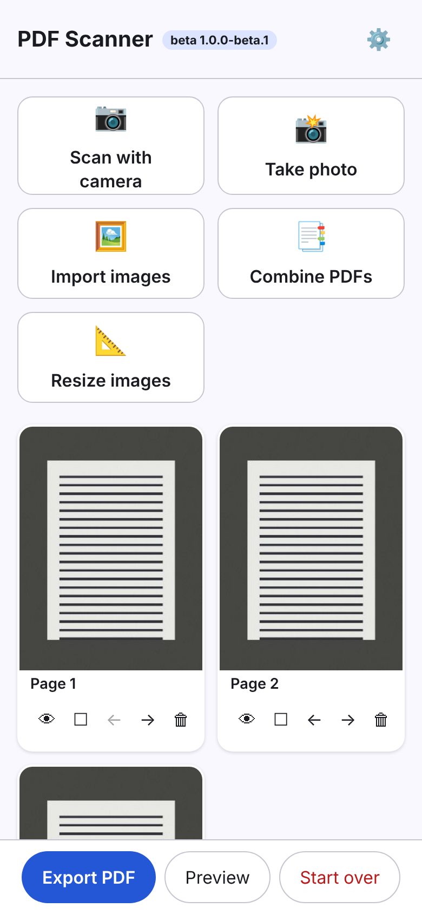
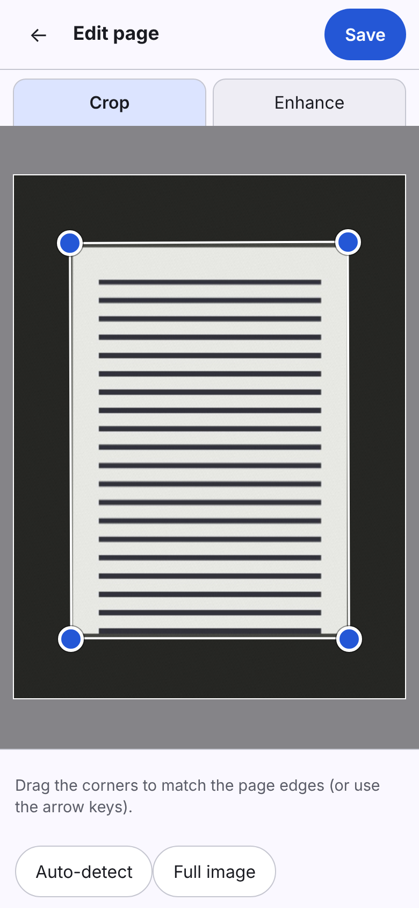
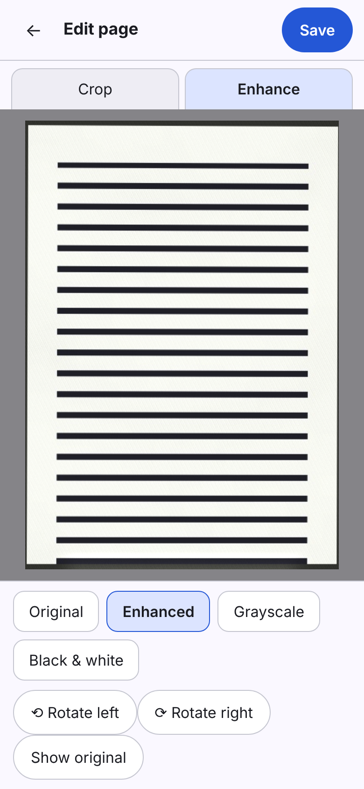
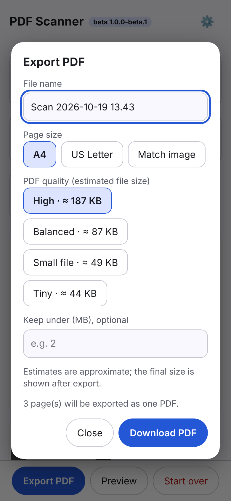
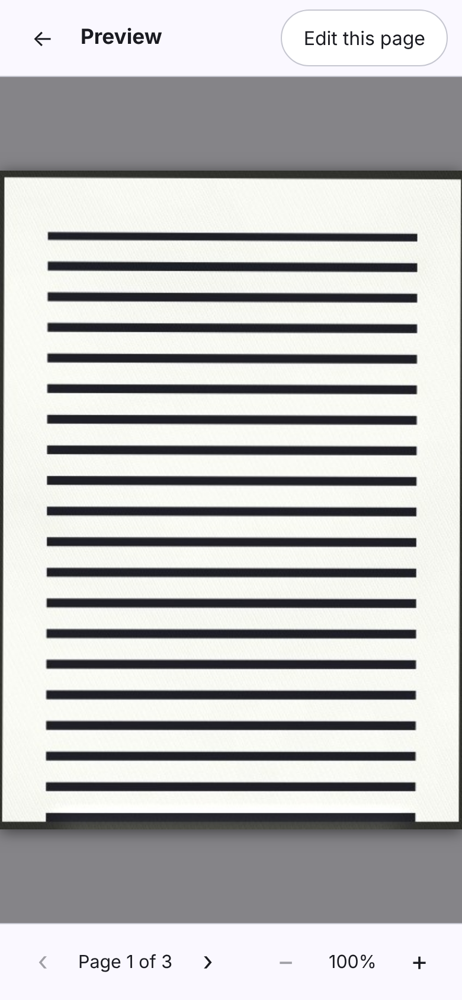
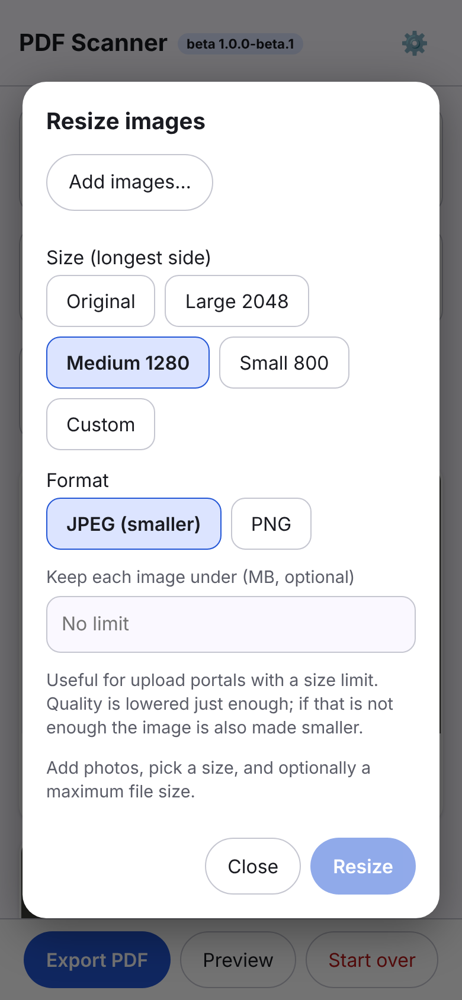

# PDF Scanner

[](https://github.com/SaiTejaVoonna/pdf-scanner/actions/workflows/android.yml)
[](https://github.com/SaiTejaVoonna/pdf-scanner/releases/download/latest-debug/pdf-scanner-debug.apk)


A free, offline Android app for turning photos and PDFs into clean PDFs. No accounts, no ads, no
analytics, no uploads: it has no internet permission at all.

> **Beta (`1.0.0-beta.1`).** It works end to end, but it is young. Expect rough edges, and please report
> them. See [docs/ROADMAP.md](docs/ROADMAP.md) for what is done and what is planned.

## Two versions, same principles

| | Android app (`app/`) | Web app (`web/`) |
| --- | --- | --- |
| Runs on | Android 8.0+ | Any modern browser: iPhone, Android, desktop. Installable, works offline |
| Get it | [Download the APK](https://github.com/SaiTejaVoonna/pdf-scanner/releases/download/latest-debug/pdf-scanner-debug.apk) | Run it locally (`web/README.md`) or enable GitHub Pages with one setting (see [docs/RELEASING.md](docs/RELEASING.md)); it then lives at `https://saitejavoonna.github.io/pdf-scanner/` |
| Combine PDFs | By importing their pages as images | Keeps text and vectors (no re-rendering) |
| File size | Quality presets | Quality presets with the **estimated size in MB** shown, plus "keep under N MB" |
| Camera | In-app CameraX | In-page live camera, or the phone's own camera app |

The web app is the newer of the two and shares the same page-detection approach. It has fewer features so far
(no library of saved documents: one working document at a time). See [web/README.md](web/README.md).

## Download

**[Download the latest beta APK](https://github.com/SaiTejaVoonna/pdf-scanner/releases/download/latest-debug/pdf-scanner-debug.apk)**
(rebuilt on every push; no sign-in needed). Open the file on your phone and allow *Install unknown apps* when
asked. It is a debug-signed build for testing, not a Play Store release.

## Screenshots

Web app (captured from the real build in headless Chromium; Android screenshots are not added yet):

| Pages | Crop (auto-detected) | Enhance | Export |
| --- | --- | --- | --- |
|  |  |  |  |

| Preview | Resize images |
|---|---|
|  |  |

Dark mode: [pages](docs/screenshots/web-pages-dark.png).

## What it does today

**Scan and import**
- Capture pages with the camera (CameraX, flash toggle), or import photos with the system Photo Picker.
- Import existing **PDFs** and add their pages to a document. This is how you **combine, split and reorder**
  PDFs: import several, reorder, delete the pages you do not want, export.
- Several pages per document; unfinished scans are kept as drafts and can be resumed.

**Crop, clean up and edit**
- **Auto-crop is optional.** Settings has separate switches for camera photos (on by default) and imported
  images (off by default). A page can always be cropped by hand with draggable corners and perspective
  correction, or reset to the full image.
- **Per page or many at once:** long-press a page to select; tap more; then auto-crop, remove crop, rotate or
  apply a filter to all selected pages, or delete them.
- Filters: **Original**, **Enhanced** (removes shadows and uneven lighting, whitens paper, keeps colour),
  **Grayscale**, **Black & white** (adaptive threshold). Rotate left/right.

**Export and share**
- Real multipage PDF: custom file name, page size (**A4**, **US Letter**, or match each image), and a
  **quality** preset (High, Balanced, Small file) to control file size.
- Save anywhere with the system file picker, or share through a `FileProvider` link with a temporary grant.

**Tools**
- **Resize images**: pick photos, choose a longest side (2048 / 1280 / 800 / original), JPEG quality or PNG,
  and save copies to a folder you choose. Originals are never touched.

**Library**
- Search, rename, delete with confirmation, share. Dark mode and TalkBack labels throughout.

## Not implemented yet

OCR / searchable PDFs, folders in the library, password-protected PDFs (they are skipped on import), PDF
password protection on export, Google Drive or any cloud sync, custom page sizes, a Play Store release. See the
[roadmap](docs/ROADMAP.md).

## Requirements

| Tool | Version |
| --- | --- |
| JDK | 17 or newer |
| Android SDK | Platform 35, Build-Tools 35 (Android Studio installs these) |
| Device | Android 8.0 (API 26) or newer. A camera is optional; import works without one |

## Build and run

```bash
echo "sdk.dir=$ANDROID_HOME" > local.properties   # once; Android Studio does this for you
./gradlew assembleDebug                            # app/build/outputs/apk/debug/app-debug.apk
./gradlew installDebug                             # install on a connected device or emulator
./gradlew testDebugUnitTest lintDebug              # tests and lint
```

Open the folder in Android Studio and press Run if you prefer. `./gradlew assembleRelease` produces an
**unsigned, non-installable** APK (it only proves the minified build compiles). Publishing on Google Play would
need a properly signed AAB with an owner-managed key, which is not set up here.

## Privacy, permissions and network

- Permissions: **`CAMERA`** only, requested when you open the scanner. **No `INTERNET` permission**, so the app
  cannot send data anywhere, and nothing is downloaded after install.
- Photos come from the system Photo Picker and PDFs/folders from the system file picker, so the app never needs
  broad storage access.
- Scans live in app-private storage and are excluded from cloud backup and device transfer. Shared PDFs are
  temporary copies in the cache, exposed through a narrowly scoped `FileProvider`, and cleared when stale.
- If camera permission is denied (or there is no camera) the scanner explains how to grant it and offers
  *Import photos* instead.

## How page detection works (and where it fails)

Auto-crop uses no Google services and no native libraries: Canny edges, a Hough transform for straight
lines, then every plausible quadrilateral is scored by how well its sides sit on real edges, how much of
the image it covers, and whether there is a real brightness/colour step across each side. It declines to guess
rather than return a bad crop. Details: [docs/PAGE_DETECTION.md](docs/PAGE_DETECTION.md).

It is still a heuristic. Busy backgrounds, overlapping papers or heavy glare can fool it, which is why manual
corners, "remove crop" and the switch to turn auto-crop off always exist.

## Project layout

```
app/src/main/java/com/saiteja/pdfscanner/
├── ui/        Compose screens and ViewModels (home, camera, document, edit, tools), theme, navigation
├── domain/    Pure Kotlin models and logic (geometry, page order, file names, image sizing)
├── data/      Room database, repository, settings, on-disk file store
├── imaging/   Edge detection, perspective warp, filters, import/render, PDF page import, resizer
└── pdf/       PDF writer and exporter
```

More in [docs/ARCHITECTURE.md](docs/ARCHITECTURE.md). Tests mirror this layout in `app/src/test/`
([docs/TESTING.md](docs/TESTING.md)). The web app lives in `web/` (see [web/README.md](web/README.md)).

## Contributing

Welcome. Read [CONTRIBUTING.md](CONTRIBUTING.md). Releases: [docs/RELEASING.md](docs/RELEASING.md).

## License

**No license has been selected yet.** The owner intends this to be open source; until a license file is added,
default copyright applies and others have no permission to reuse the code.
