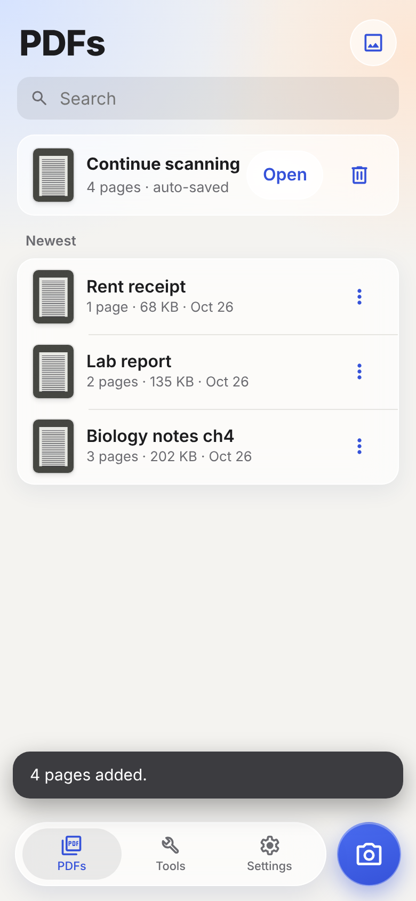
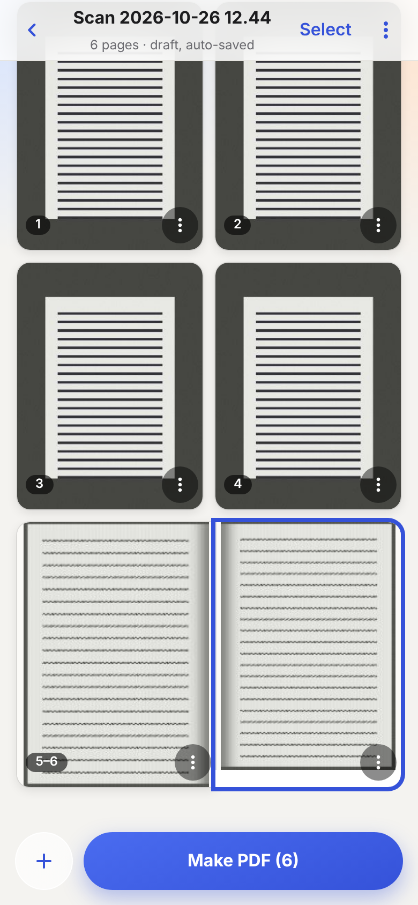
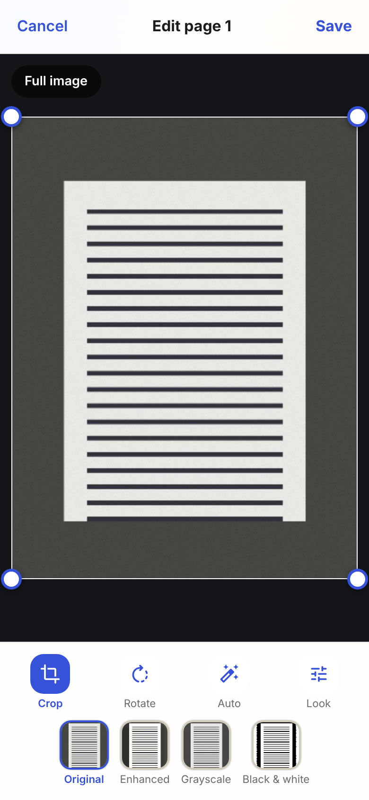
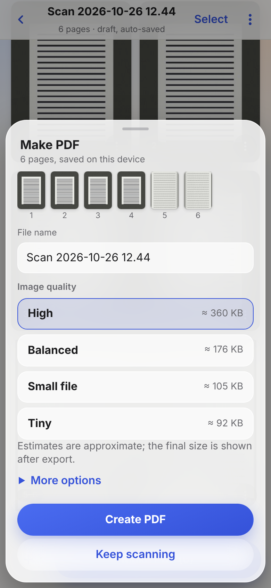
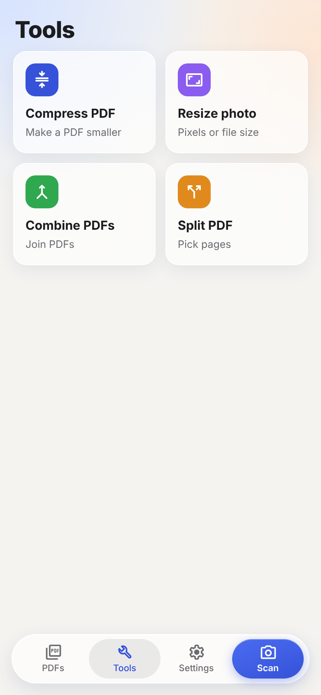
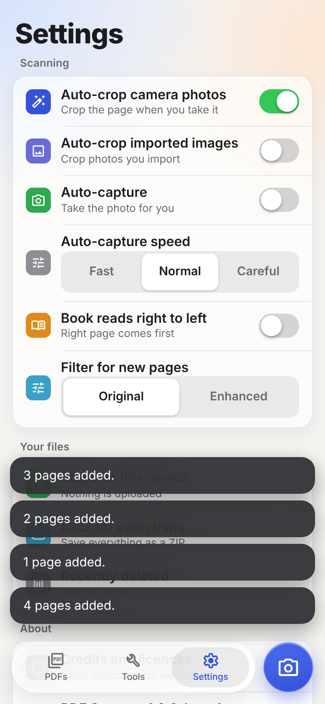

# PDF Scanner

### Try it: **[saitejavoonna.github.io/pdf-scanner](https://saitejavoonna.github.io/pdf-scanner/)**

Open the link on your phone, then *Add to Home Screen*. That's the whole install.

A free scanner that turns photos of paper into clean PDFs, plus a few PDF tools I kept needing. It runs entirely in
your browser. No account, no watermark, and your pages never leave your phone. It also works offline once
it has loaded once.

[](https://github.com/SaiTejaVoonna/pdf-scanner/actions/workflows/web.yml)
[](https://github.com/SaiTejaVoonna/pdf-scanner/actions/workflows/android.yml)


| PDFs | Pages | Edit a page | Make PDF | Tools | Settings |
| --- | --- | --- | --- | --- | --- |
|  |  |  |  |  |  |

<sub>Screenshots are taken from the real app by `web/e2e/screenshots.mjs`, with made-up sample pages.</sub>

## What it does

**Scan**
- Live camera with a page outline and optional auto-capture, or pick photos from your gallery.
- Auto-crop finds the page and straightens it. If it's a bit off, drag a corner.
- Looks: Original, Enhanced (removes shadows, whitens the paper), Grayscale, Black & white.
- Book spreads: one photo of an open book becomes a left and a right page.
- Unfinished scans are saved as a draft, so you can close the app and carry on later.

**Make the PDF**
- Pick a quality and see the estimated file size before you save (High, Balanced, Small file, Tiny).
- Or set a limit ("keep under 1 MB") and it picks the best quality that fits.

**Tools**
- Compress PDF, Resize photo (by pixels or file size), Combine PDFs, Split PDF.
- Combining keeps text and vectors as they are. Nothing gets re-rendered into a blurry image.

**Not there yet:** OCR / searchable text, sync, password-protected PDFs. Auto-crop is good, not perfect: busy
backgrounds and glare can still fool it, which is why you can always fix corners by hand.

## Privacy

Everything happens on your device. The app has no server and makes no requests to other sites. Scans are kept in your
browser's storage, and Settings has *Back up everything* because browsers can clear site data.

## How the page detection works

Two parts working together:
1. Classic computer vision: edges, straight lines, then every plausible four-sided shape is scored by how well it sits on
   real edges.
2. A small neural network (about 1 MB, runs in the browser) that predicts the four corners.

The app combines the two, and the outline only turns green when it's confident. Details and measurements:
[docs/PAGE_DETECTION.md](docs/PAGE_DETECTION.md) and [docs/ML_EVALUATION.md](docs/ML_EVALUATION.md). A bigger
model is in training and only ships if it beats the current one on real photos.

## Android

There is a native Android version in `app/` (Kotlin, Jetpack Compose, no internet permission at all). It's an early
beta and behind the web app. A proper Android release is coming. Meanwhile you can try the
[debug APK](https://github.com/SaiTejaVoonna/pdf-scanner/releases/download/latest-debug/pdf-scanner-debug.apk).

## Run it yourself

```bash
cd web
npm ci
npm run dev      # http://localhost:5173
npm test         # 128 unit tests
npm run e2e      # 57 browser tests (Playwright)
```

Android: `./gradlew assembleDebug`. See [CONTRIBUTING.md](CONTRIBUTING.md).

## What's in the repo

```
web/      The web app (TypeScript, Vite, pdf-lib). This is what the link above runs.
  ml/     Training code for the corner model (PyTorch)
  bench/  Benchmarks on real photos
app/      The native Android app (Kotlin)
docs/     Design notes, screenshots, logo drafts
promo/    The Instagram Reel: Remotion source, screen captures, voiceover
```

## Credits

Concept and direction by **Sai Teja Voonna** ([@SaiTejaVoonna](https://github.com/SaiTejaVoonna)).
Code by [Claude Code](https://claude.com/claude-code), Anthropic's AI coding agent.

This is an AI-assisted build, and I want to be upfront about the split. The idea is mine, and so are the calls: what
the app should do, what to cut, how it should look and feel, and what wasn't good enough yet. I tried it on my phone,
sent real photos of pages to test with, and asked for changes until it felt right. Claude wrote the code, the tests and
the docs, trained the corner model, and made the promo Reel, all from my prompts and feedback.

Thanks to these open-source projects and datasets:
- [pdf-lib](https://github.com/Hopding/pdf-lib) (MIT) for everything PDF
- [Material Symbols](https://github.com/google/material-design-icons) (Apache 2.0) for the icons
- The [Mendeley document corners dataset](https://data.mendeley.com/datasets/x3nm4cxr83) (CC BY 4.0), used to train the next corner model
- [Remotion](https://www.remotion.dev/), [Kokoro TTS](https://huggingface.co/hexgrad/Kokoro-82M) and Mixkit sounds, for the Reel

Full list: [docs/THIRD_PARTY.md](docs/THIRD_PARTY.md). What changed and when: [CHANGELOG.md](CHANGELOG.md).

## License

No license yet, so default copyright applies: you can look and try the app, but not reuse the code. I plan to pick an
open-source license soon.
